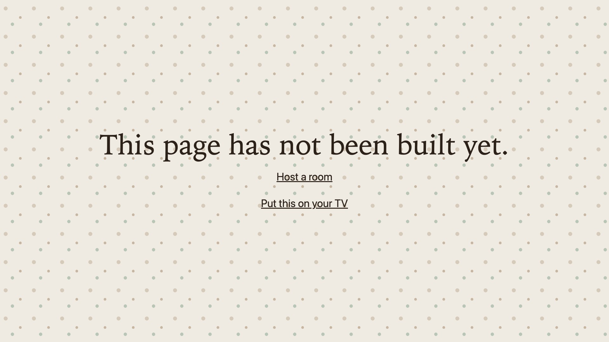
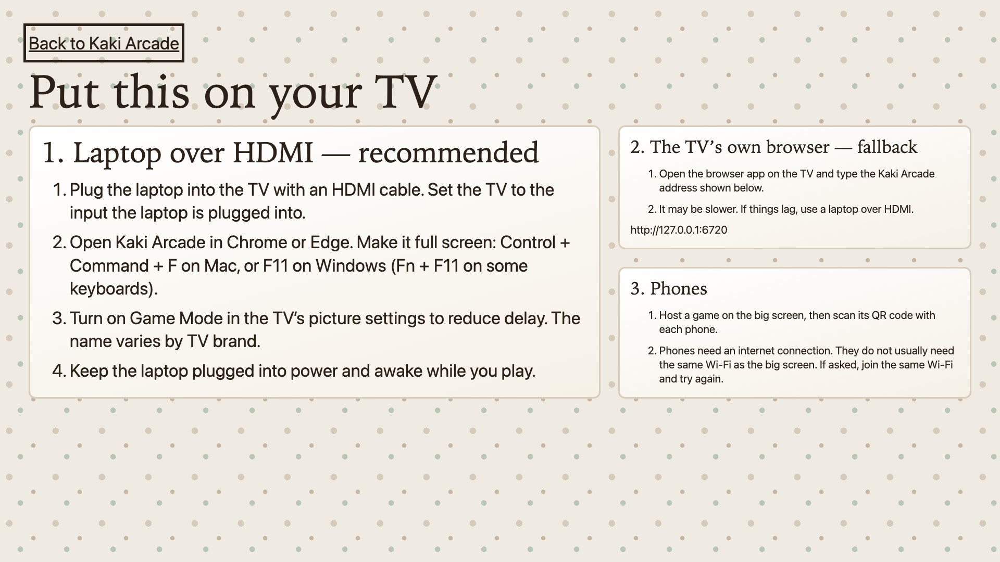
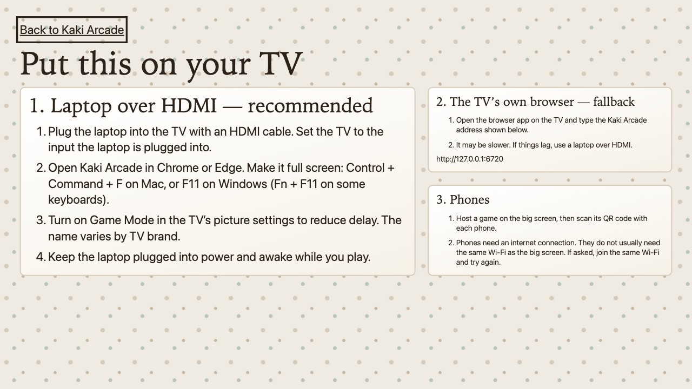
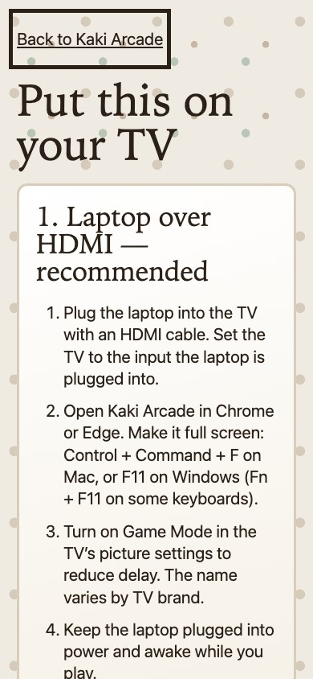
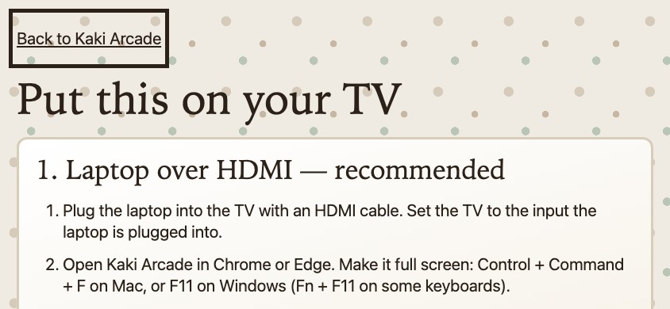

# X-02-tv-help UAT evidence

Automated execution only. Visual review and acceptance decisions are pending.

Command: `node tools/uat/run.mjs -- X-02-tv-help --phones 1 --out round1`
Commit: `d3aaa80e09b949f5dd50b067741cfbe2fc607e20`
Viewports: 1920×1080, 1280×720, 390×844, 844×390

| Timing | ms | Status |
|---|---:|---|
| Landing link opens the help page lazily | 895.8 | completed |
| Help at 1920 × 1080 | 156.9 | completed |
| Help at 1280 × 720 | 153.8 | completed |
| Help at 390 × 844 | 147.7 | completed |
| Help at 844 × 390 | 130.7 | completed |

Expected errors (count):
None

## Real server

| Screenshot | What it shows | Looked at by |
|---|---|---|
|  | | |
|  | | |
|  | | |
|  | | |
|  | | |

| Acceptance statement | Pass / fail | Evidence |
|---|---|---|
| | | |
