# X-02-tv-help UAT evidence

Every still opened and checked by the integrator on 2026-11-18. No sideways overflow on any phone still.

Command: `node tools/uat/run.mjs -- X-02-tv-help --phones 1 --out round3`
Commit: `731e6b54a8d7758dc2cb7e5a6a19e37e48f7a31b`
Viewports: 1920×1080, 1280×720, 960×540, 390×844, 844×390

| Timing | ms | Status |
|---|---:|---|
| Landing link opens the help page lazily | 880.4 | completed |
| Help at 1920 × 1080 | 179.5 | completed |
| Help at 1280 × 720 | 150.5 | completed |
| Help at 960 × 540 | 128.8 | completed |
| Help at 390 × 844 | 464.2 | completed |
| Help at 844 × 390 | 647.9 | completed |

Expected errors (count):
None

## Real server

| Screenshot | What it shows | Looked at by |
|---|---|---|
| 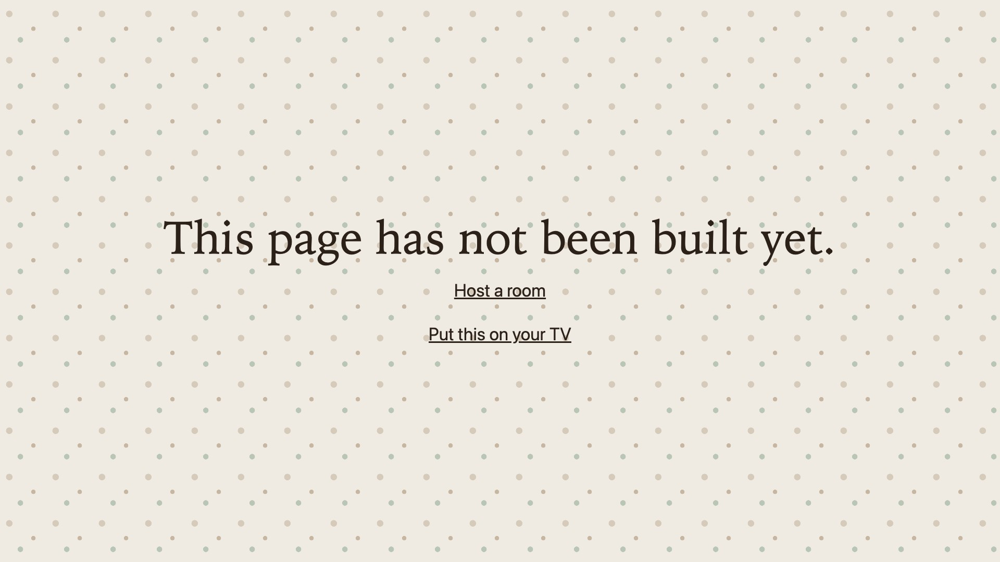 | Placeholder landing page with the "Put this on your TV" link under "Host a room". | Integrator (Claude) |
| 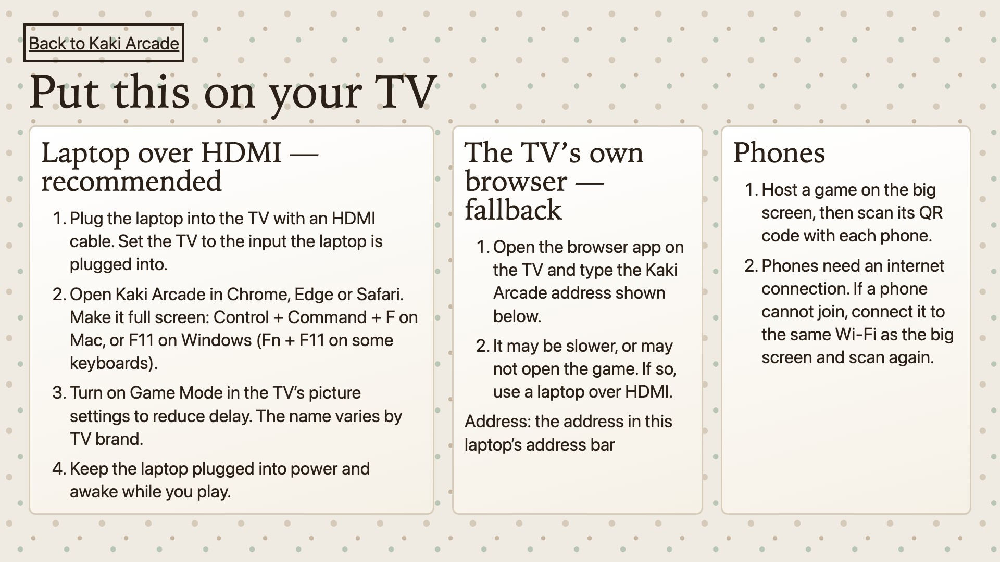 | 1920 × 1080: three panels at 1.618 : 1 : 1, 34 px body and 55 px headings, all inside the safe margin; address line in DM Sans. | Integrator (Claude) |
| 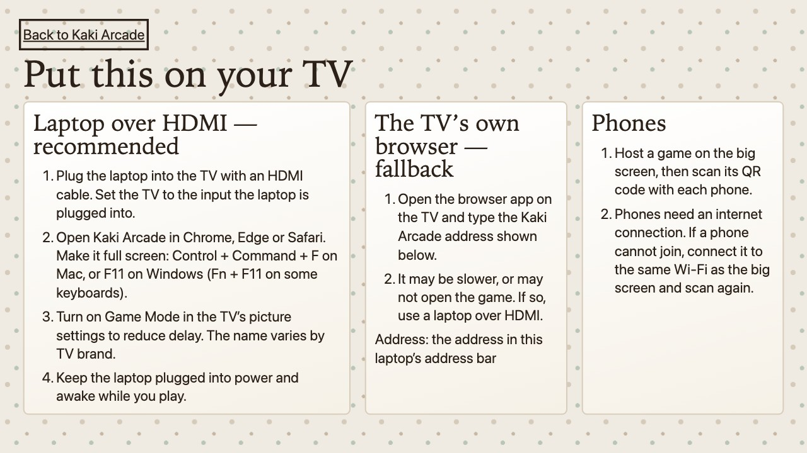 | The same board scaled to 1280 × 720, no scroll. | Integrator (Claude) |
| 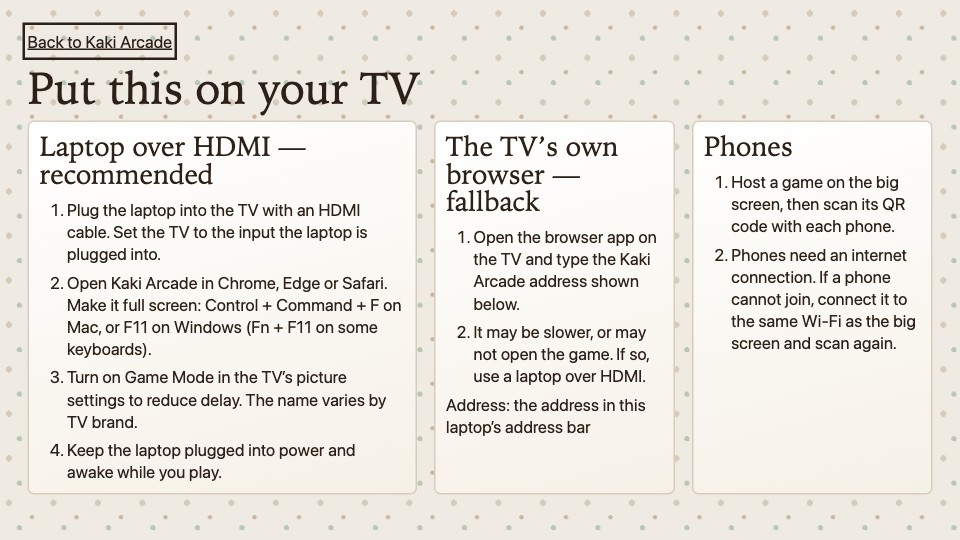 | The same board at 960 × 540 (scale 0.5), no scroll, nothing cut off. | Integrator (Claude) |
| 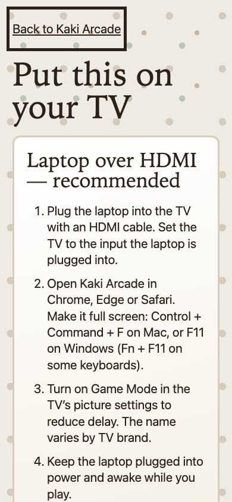 | Phone 390 × 844, top of the page. | Integrator (Claude) |
| 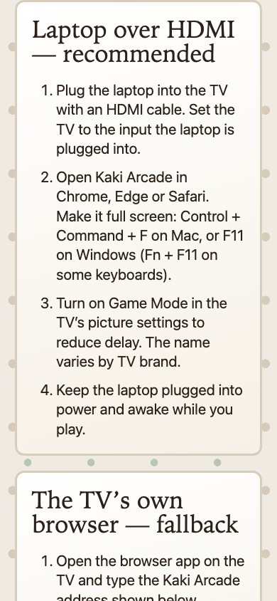 | Phone 390 × 844 scrolled through the laptop steps. | Integrator (Claude) |
| 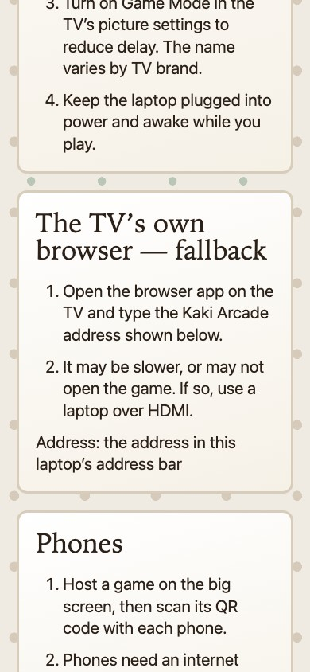 | Phone 390 × 844: end of laptop steps, TV browser fallback with the address line, start of Phones. | Integrator (Claude) |
| 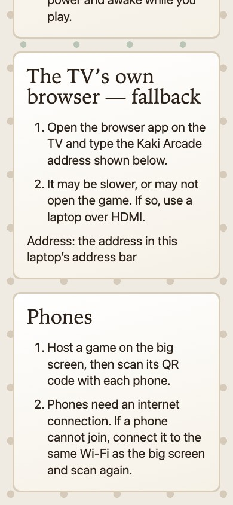 | Phone 390 × 844: TV browser fallback and Phones. | Integrator (Claude) |
|  | Phone 390 × 844 at the end of the page (repeats 08: the page stops scrolling there). | Integrator (Claude) |
| 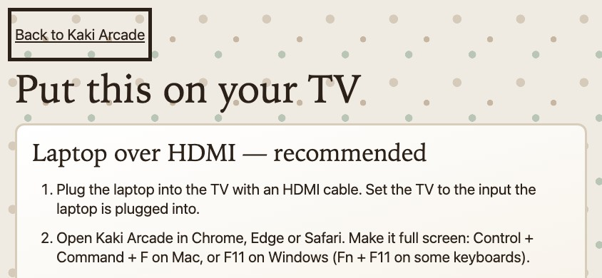 | Phone 844 × 390, top of the page. | Integrator (Claude) |
| 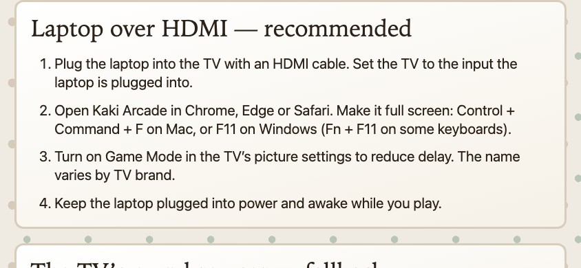 | Phone 844 × 390: all four laptop steps. | Integrator (Claude) |
| 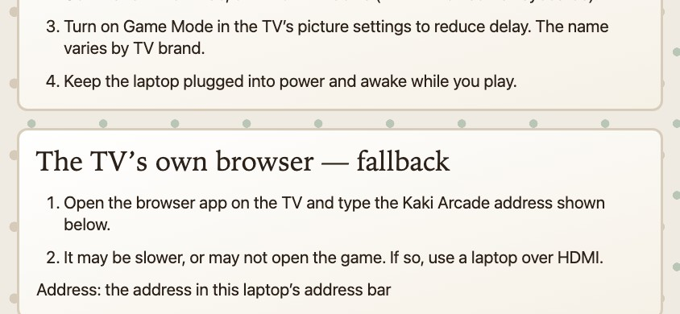 | Phone 844 × 390: laptop steps 3–4 and the TV browser fallback. | Integrator (Claude) |
| 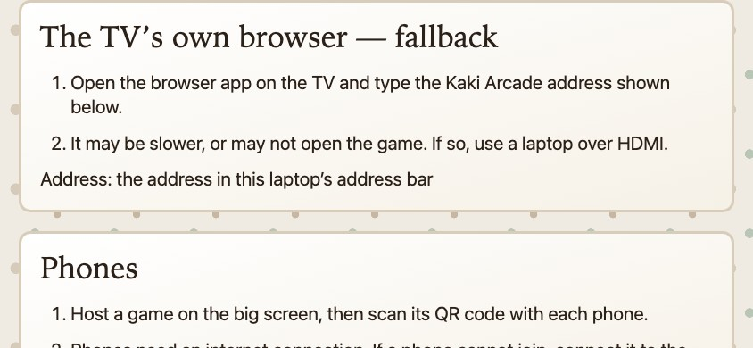 | Phone 844 × 390: TV browser fallback and the start of Phones. | Integrator (Claude) |
|  | Phone 844 × 390: fallback and the whole Phones panel. | Integrator (Claude) |
|  | Phone 844 × 390 at the end of the page (repeats 14). | Integrator (Claude) |
| 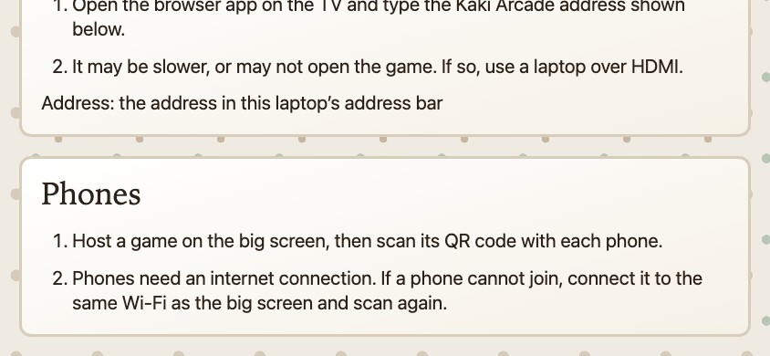 | Phone 844 × 390 at the end of the page (repeats 14). | Integrator (Claude) |

| Acceptance statement | Pass / fail | Evidence |
|---|---|---|
| All steps present: laptop over HDMI (cable and input, Chrome/Edge/Safari, full-screen keys, Game Mode, power), TV browser fallback with the address, phones | Pass | 02, 11–14 |
| TV-browser and phone advice is qualified and true today and after C-02 | Pass | 02 (fallback "may not open the game"; phones "same Wi-Fi … scan again") |
| Landing link opens the page; the page's code and styles load only then | Pass | 01; UAT step asserts no tv-help request on the landing page |
| Fits the board at 1920 × 1080, 1280 × 720 and 960 × 540 without scrolling | Pass | 02, 03, 04 |
| Phones scroll vertically with no sideways overflow | Pass | 05–16 |
| Only the host address is set in mono (DESIGN §2); loopback wording in DM Sans | Pass | 02, 07; tv-help.dom.test.ts real-host case |
| PERF-020 controller start-up | Pass | median 182 ms of 2000 (5 runs, CPU 4×), uat/evidence/X-02-tv-help/perf-1 |
