# X-03-privacy-credits UAT evidence

Automated execution only. Visual review and acceptance decisions are pending.

Command: `node tools/uat/run.mjs -- X-03-privacy-credits --phones 1 --out round1`
Commit: `c56d15091df080c77fa59eefd4883363468e13ce`
Viewports: 1920×1080, 1280×720, 390×844, 844×390

| Timing | ms | Status |
|---|---:|---|
| Privacy 1920x1080 | 1445.5 | completed |
| Credits 1920x1080 | 754.0 | completed |
| Privacy 1280x720 | 884.5 | completed |
| Credits 1280x720 | 821.6 | completed |
| Privacy 390x844 | 838.8 | completed |
| Credits 390x844 | 732.2 | completed |
| Privacy 844x390 | 885.2 | completed |
| Credits 844x390 | 643.1 | completed |

Expected errors (count):
None

## Real server

| Screenshot | What it shows | Looked at by |
|---|---|---|
| 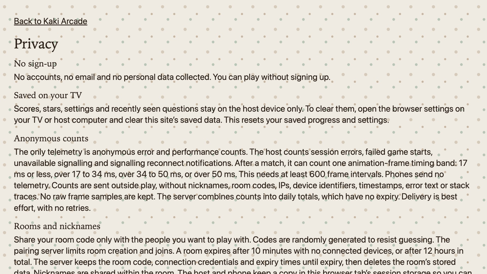 | | |
|  | | |
|  | | |
|  | | |
| 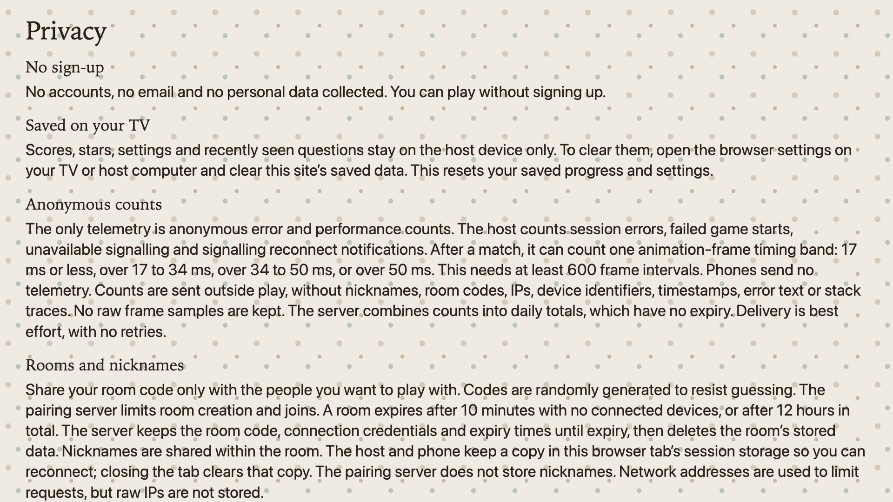 | | |
|  | | |
|  | | |
| 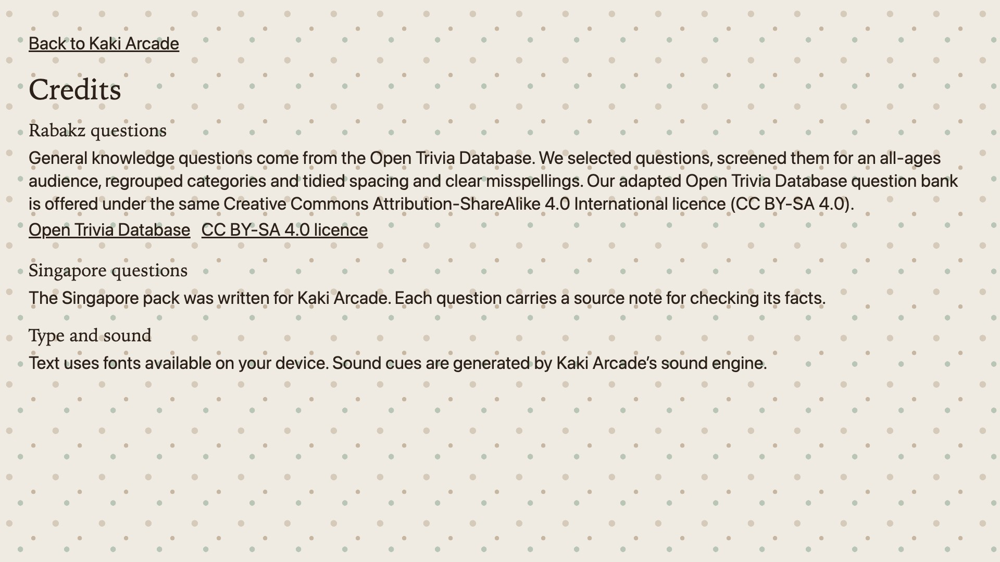 | | |
|  | | |
| 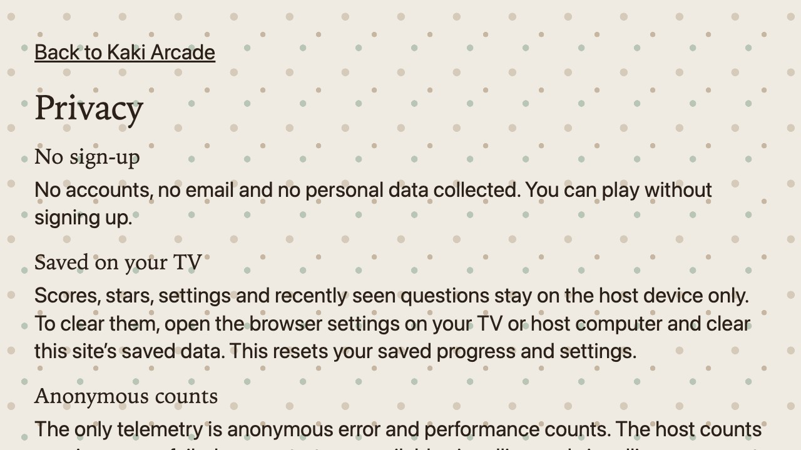 | | |
|  | | |
|  | | |
| 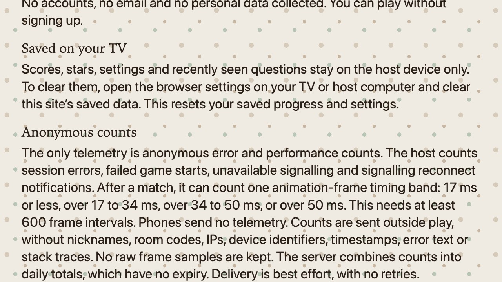 | | |
| 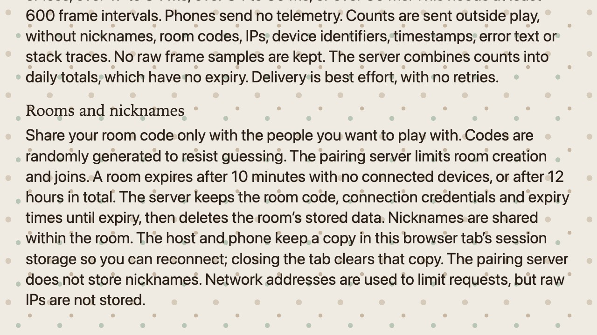 | | |
| 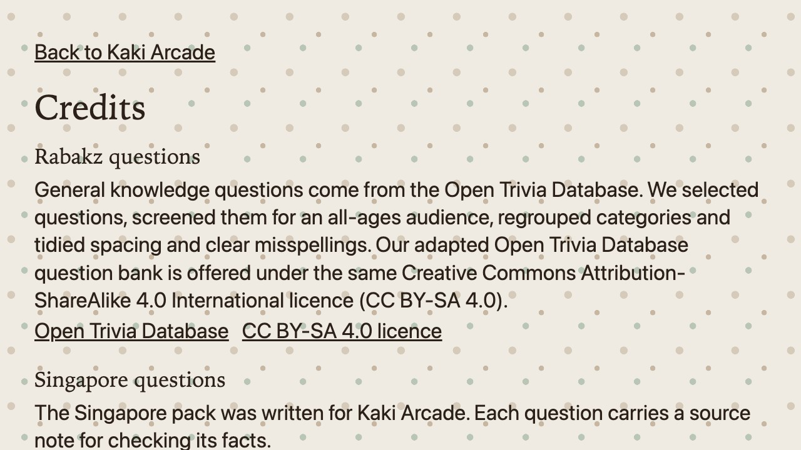 | | |
|  | | |
| 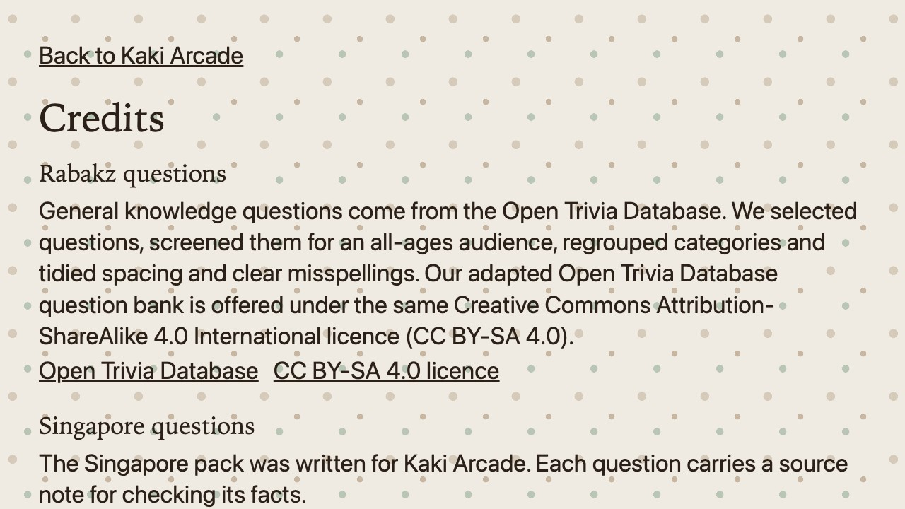 | | |
| 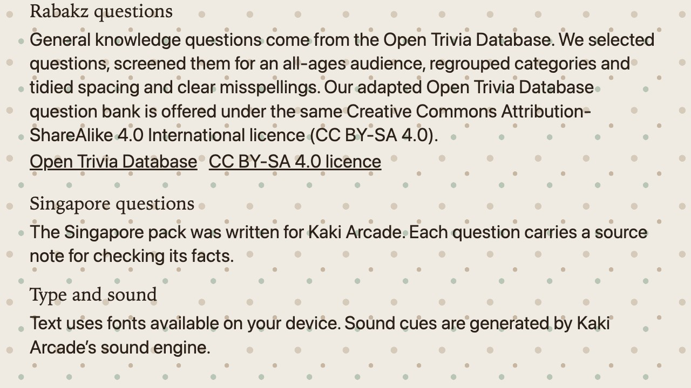 | | |
| 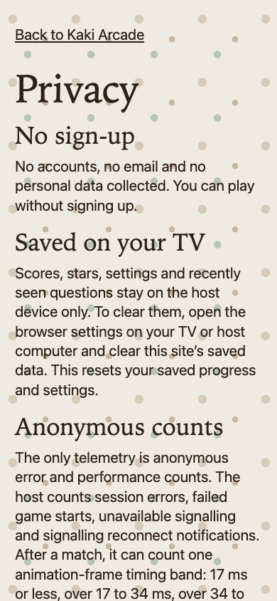 | | |
|  | | |
|  | | |
| 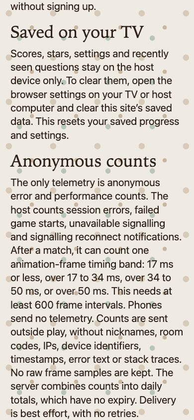 | | |
| 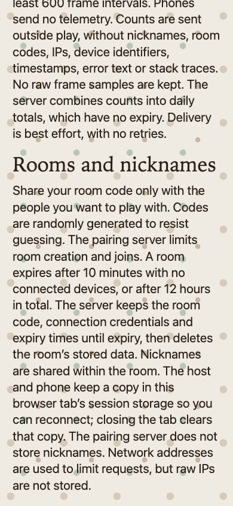 | | |
|  | | |
|  | | |
|  | | |
|  | | |
| 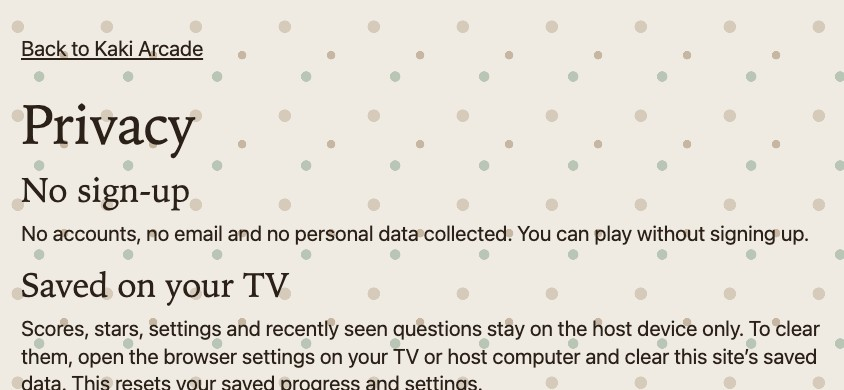 | | |
|  | | |
| 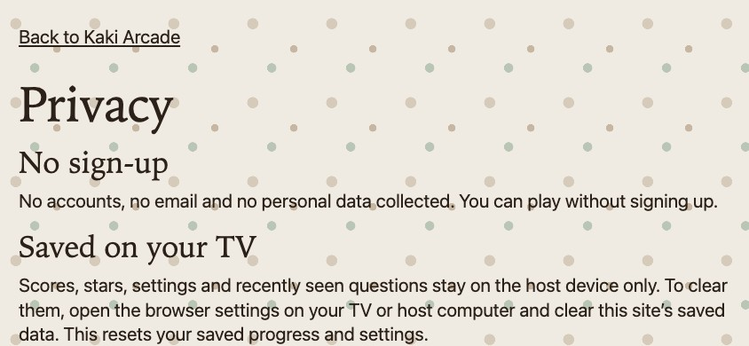 | | |
| 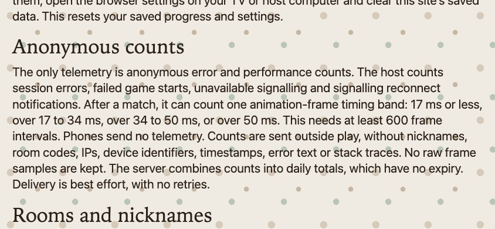 | | |
| 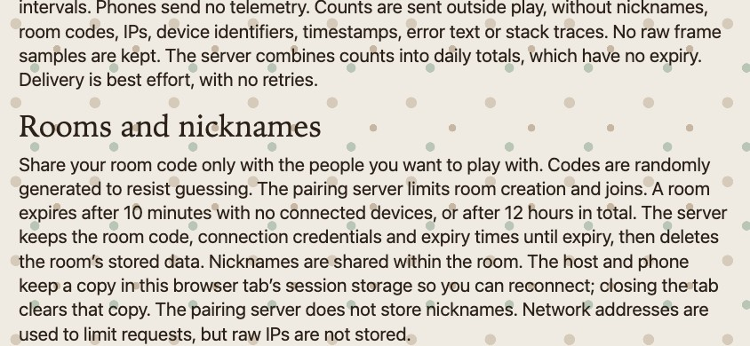 | | |
| 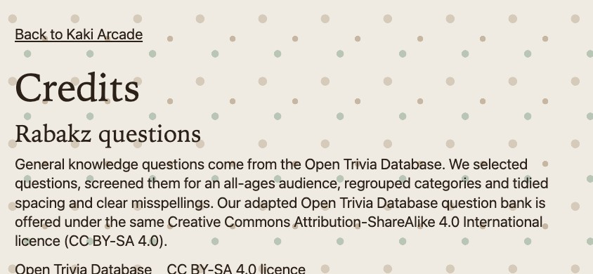 | | |
| 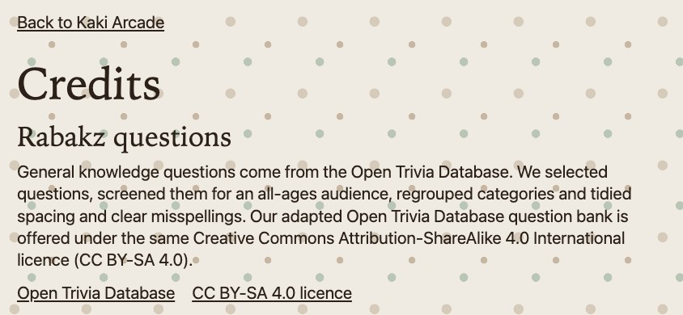 | | |
|  | | |
|  | | |

| Acceptance statement | Pass / fail | Evidence |
|---|---|---|
| | | |
