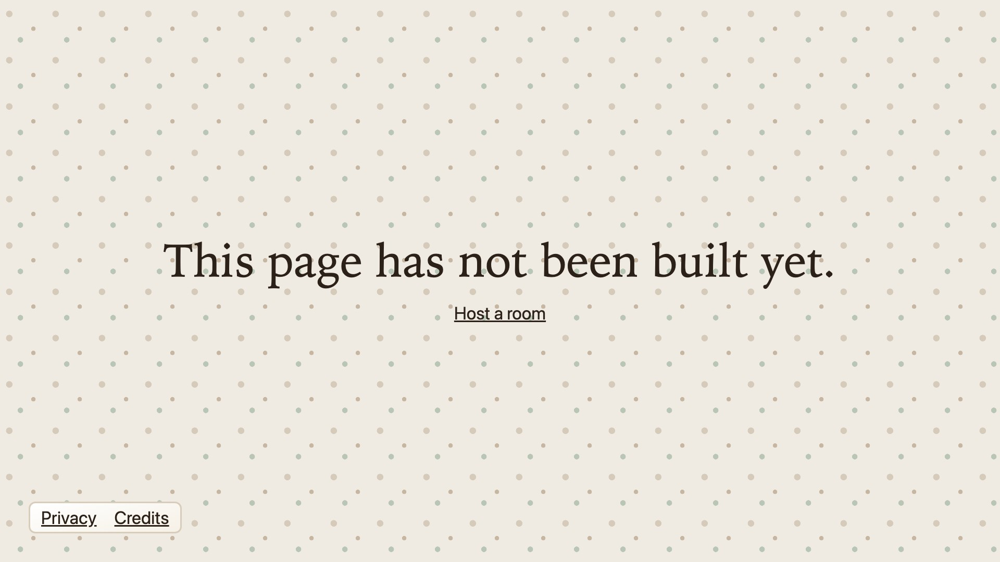
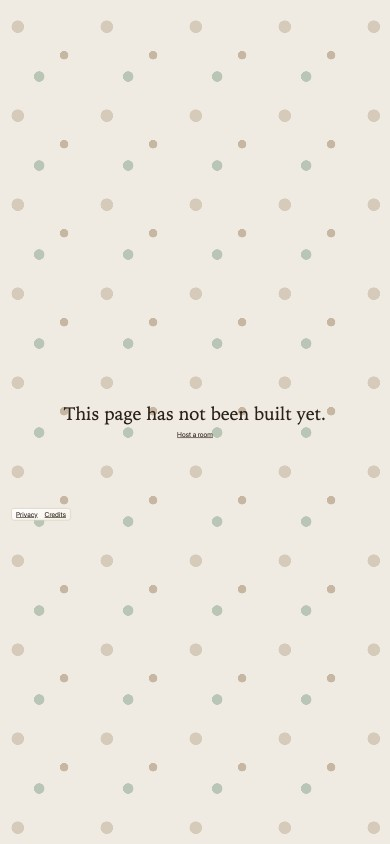
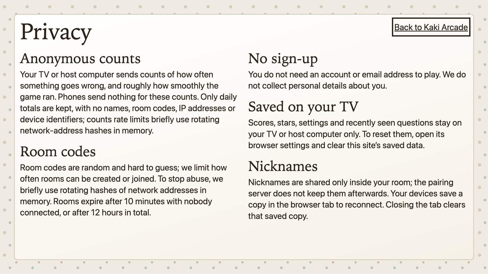
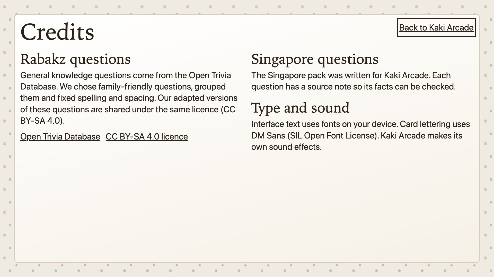
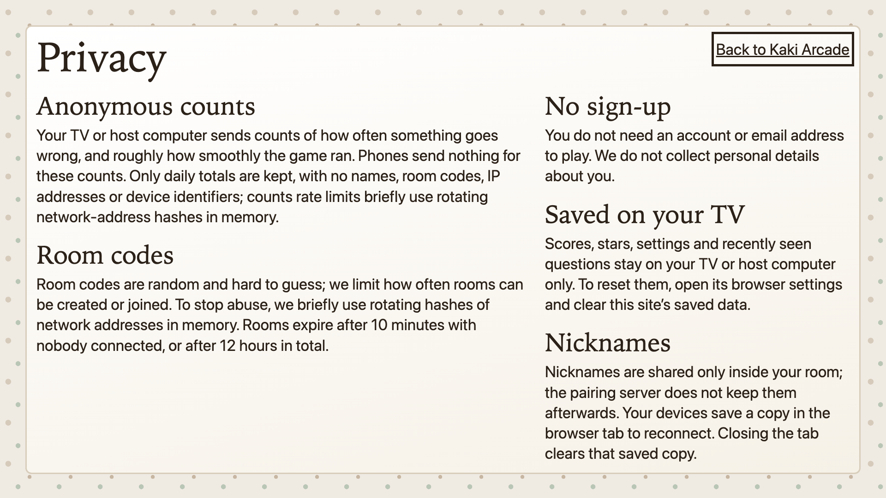

# X-03-privacy-credits UAT evidence

Automated execution only. Visual review and acceptance decisions are pending.

Command: `node tools/uat/run.mjs -- X-03-privacy-credits --phones 1 --out round3`
Commit: `fd6f7e9cfcf751ff45e50fd4ea631667755f57b6`
Viewports: 1920×1080, 390×844

| Timing | ms | Status |
|---|---:|---|
| Privacy 1920x1080 equal | 157.4 | completed |
| Credits 1920x1080 equal | 141.8 | completed |
| Privacy 1920x1080 golden | 52.4 | failed |

Expected errors (count):
None

## Real server

| Screenshot | What it shows | Looked at by |
|---|---|---|
|  | | |
|  | | |
|  | | |
|  | | |
|  | | |

| Acceptance statement | Pass / fail | Evidence |
|---|---|---|
| | | |
