# X-03-privacy-credits UAT evidence

Automated execution only. Visual review and acceptance decisions are pending.

Command: `node tools/uat/run.mjs -- X-03-privacy-credits --phones 1 --out uat-r8`
Commit: `d68aab2c8b99faeceba4d8cfb5d0e0c8e819d7b7`
Viewports: 1920×1080, 390×844, 844×390, 1280×720

| Timing | ms | Status |
|---|---:|---|
| Privacy 1920x1080 | 156.0 | completed |
| Credits 1920x1080 | 154.2 | completed |
| Privacy 1280x720 | 133.4 | completed |
| Credits 1280x720 | 148.5 | completed |
| Privacy 390x844 | 729.2 | completed |
| Credits 390x844 | 395.9 | completed |
| Privacy 844x390 | 815.3 | completed |
| Credits 844x390 | 505.0 | completed |

Expected errors (count):
None

## Real server

| Screenshot | What it shows | Looked at by |
|---|---|---|
| 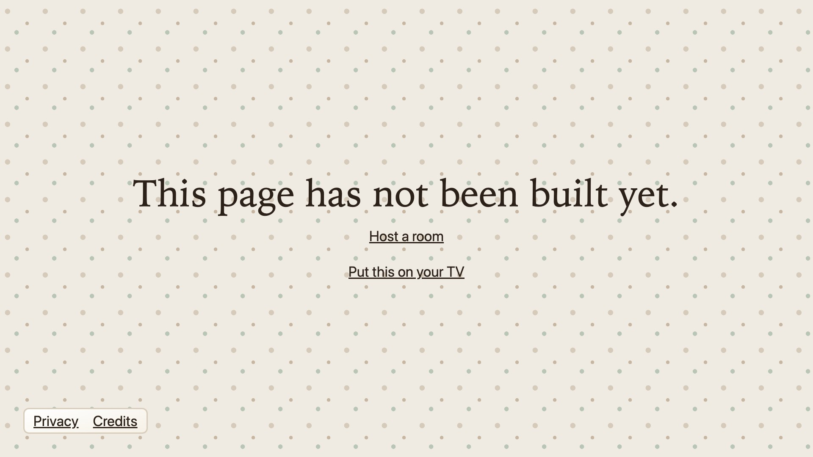 | | |
| 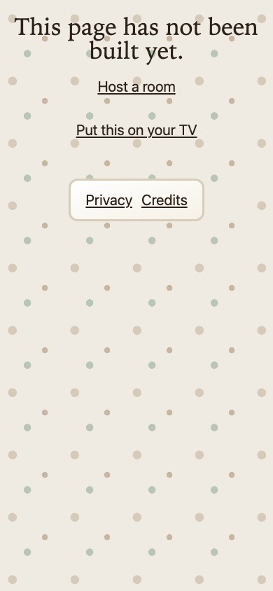 | | |
| 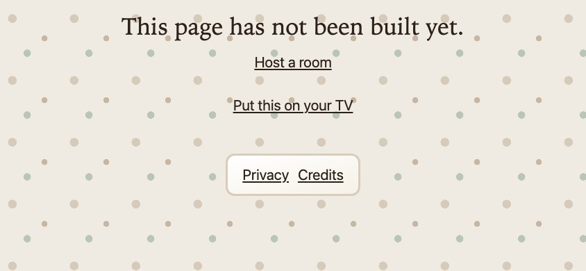 | | |
| 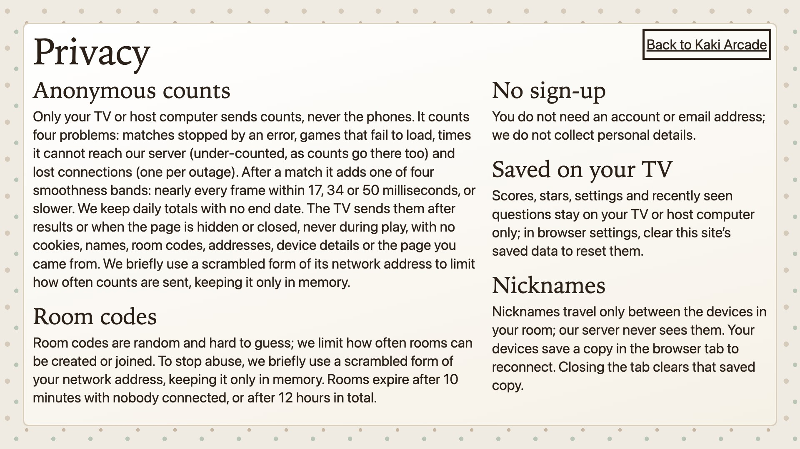 | | |
|  | | |
| 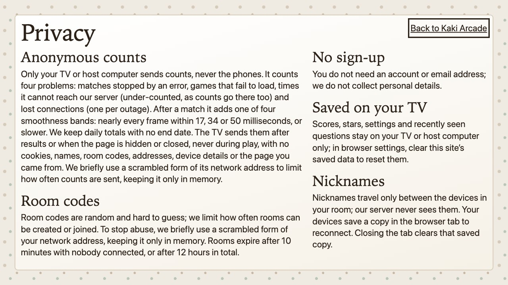 | | |
| 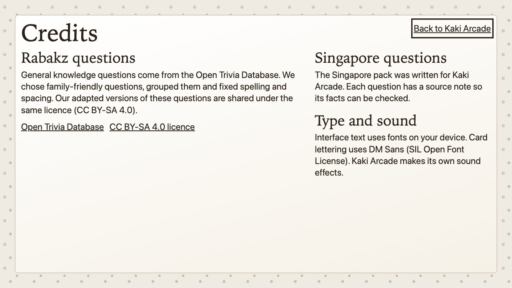 | | |
| 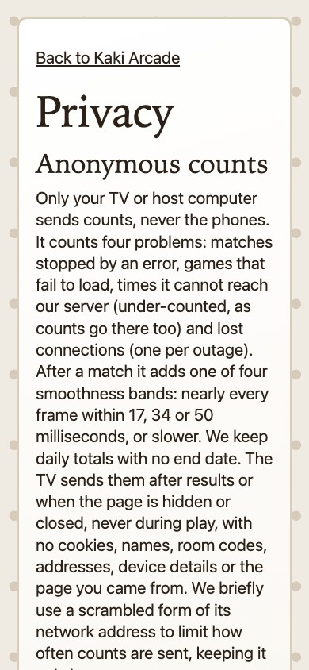 | | |
| 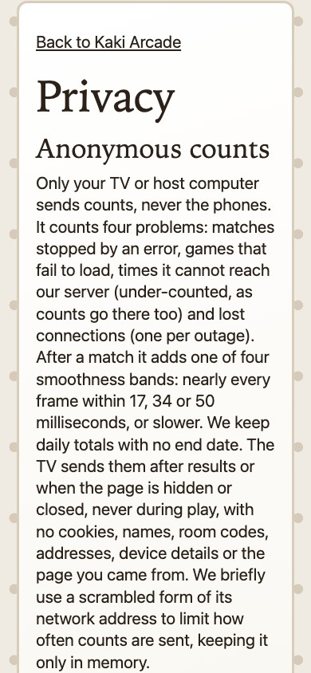 | | |
| 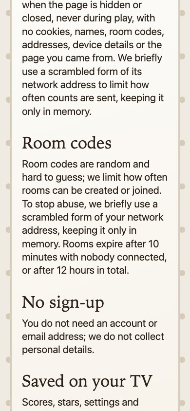 | | |
| 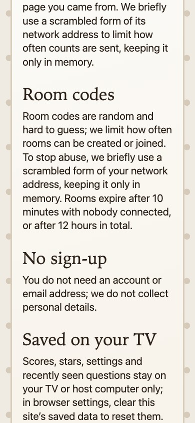 | | |
| 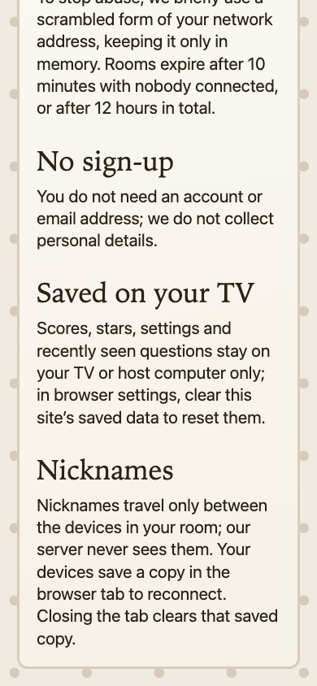 | | |
|  | | |
| 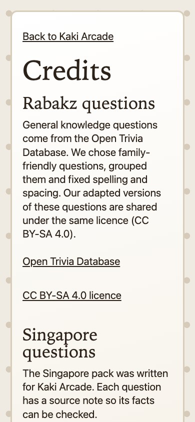 | | |
| 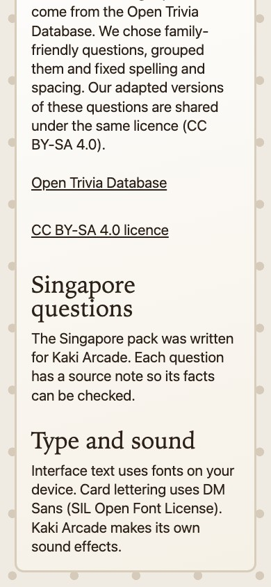 | | |
|  | | |
| 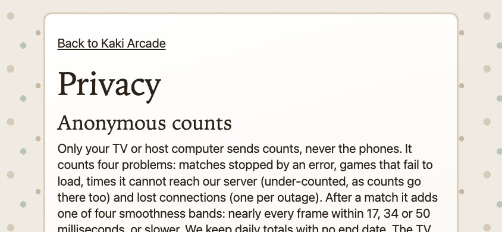 | | |
| 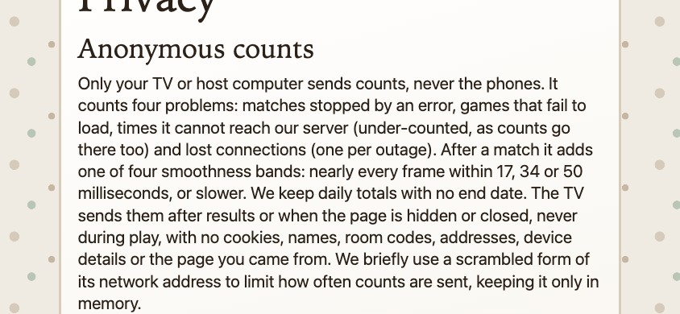 | | |
| 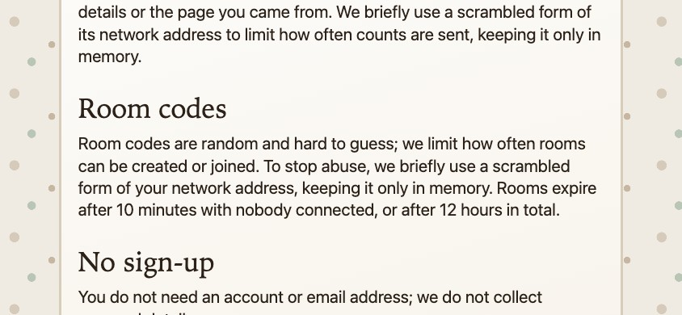 | | |
| 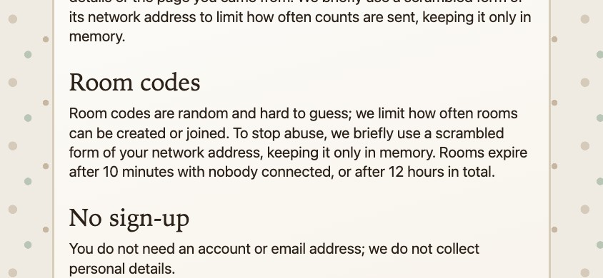 | | |
| 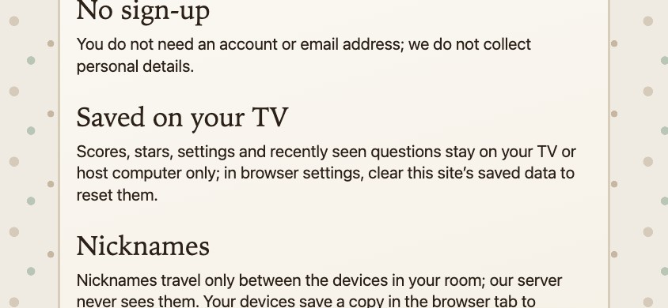 | | |
| 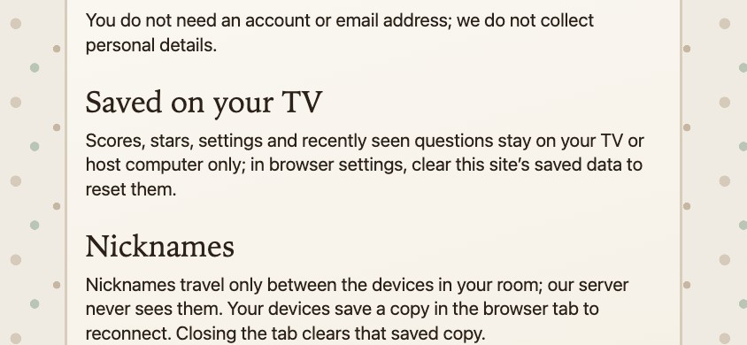 | | |
| 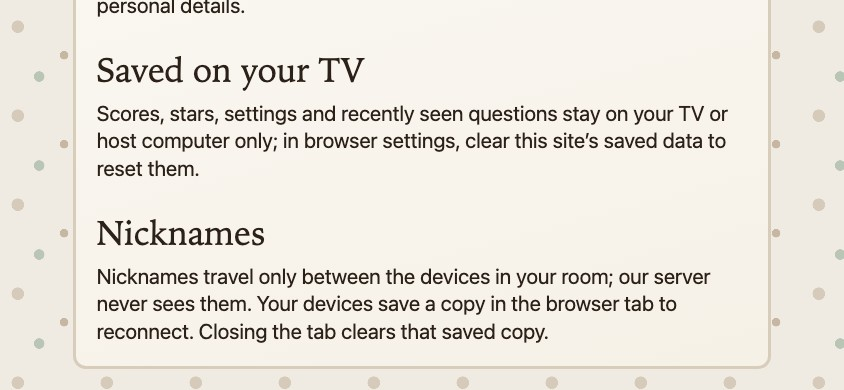 | | |
| 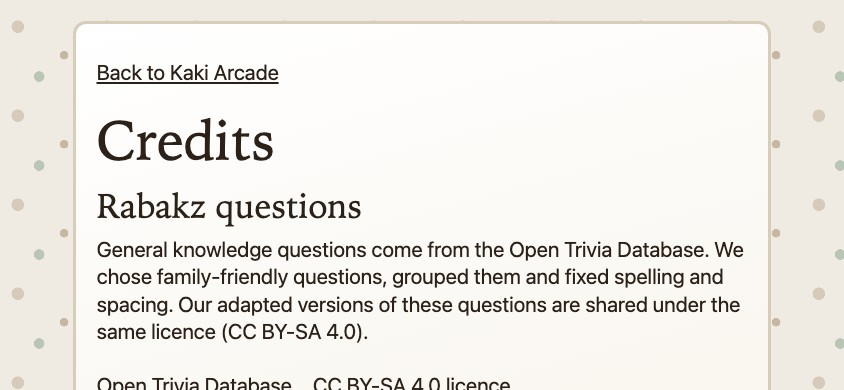 | | |
| 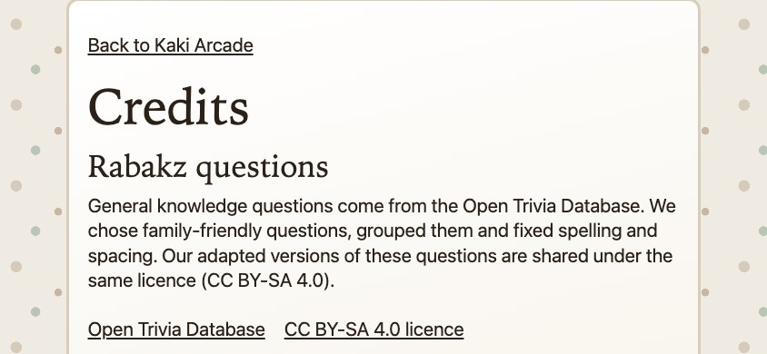 | | |
| 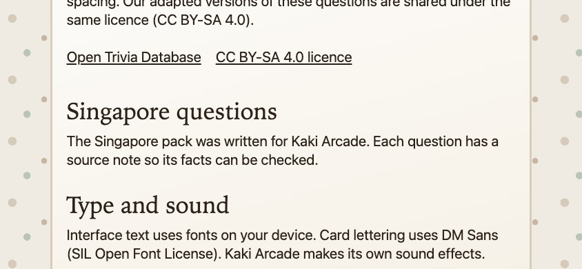 | | |
| 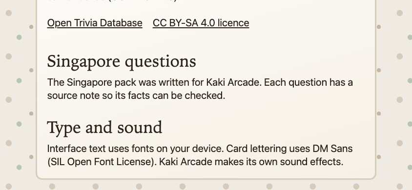 | | |

| Acceptance statement | Pass / fail | Evidence |
|---|---|---|
| | | |
