# X-03-privacy-credits UAT evidence

Automated execution only. Visual review and acceptance decisions are pending.

Command: `node tools/uat/run.mjs -- X-03-privacy-credits --phones 1 --out uat-r9`
Commit: `cab6862876b4b6c79fa7124cd223500fd76db3f8`
Viewports: 1920×1080, 390×844, 844×390, 1280×720

| Timing | ms | Status |
|---|---:|---|
| Privacy 1920x1080 | 159.1 | completed |
| Credits 1920x1080 | 155.6 | completed |
| Privacy 1280x720 | 151.0 | completed |
| Credits 1280x720 | 148.5 | completed |
| Privacy 390x844 | 762.7 | completed |
| Credits 390x844 | 413.8 | completed |
| Privacy 844x390 | 796.8 | completed |
| Credits 844x390 | 478.7 | completed |

Expected errors (count):
None

## Real server

| Screenshot | What it shows | Looked at by |
|---|---|---|
| 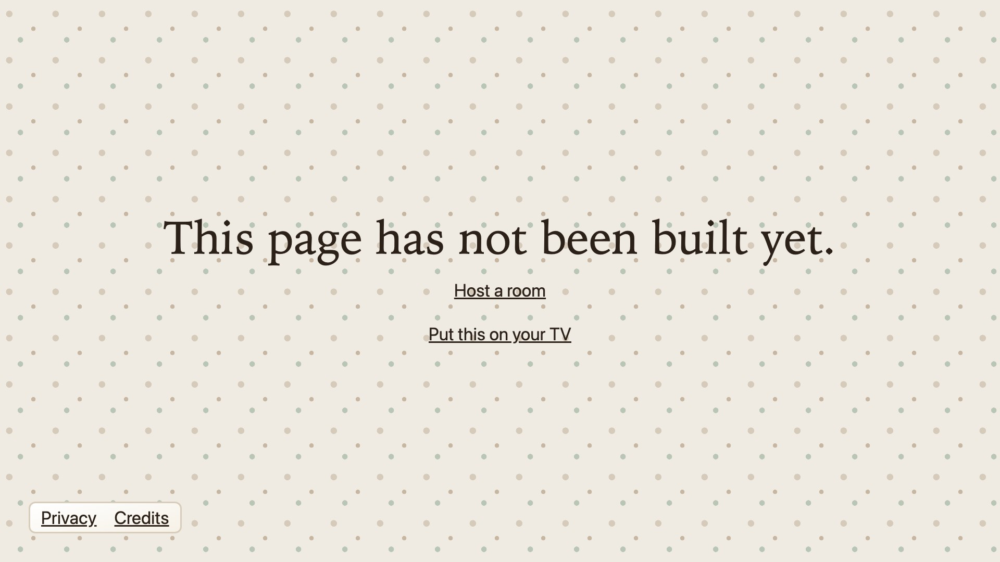 | | |
| 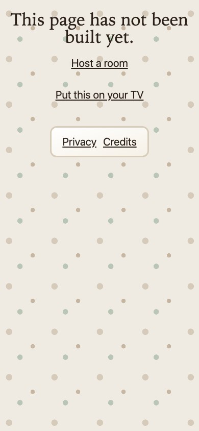 | | |
| 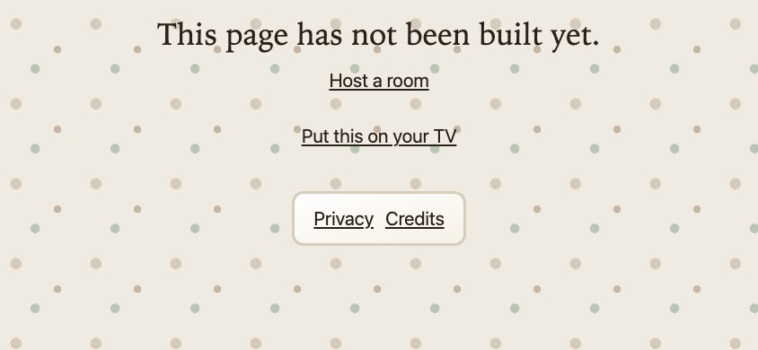 | | |
| 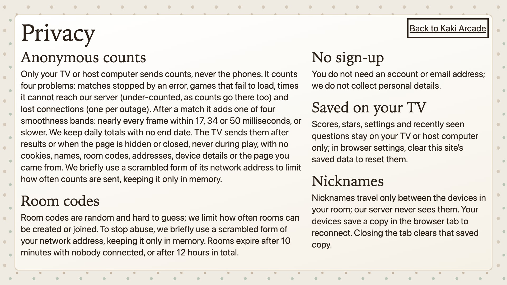 | | |
|  | | |
| 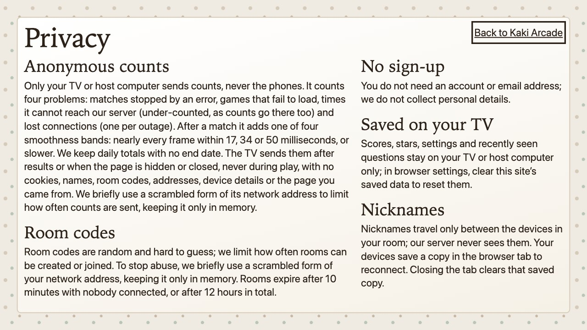 | | |
| 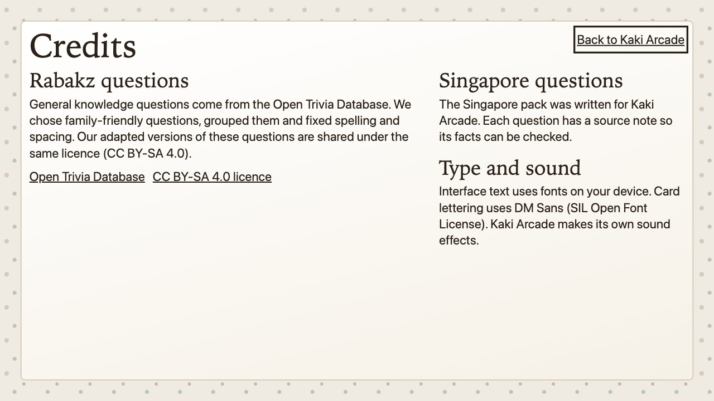 | | |
| 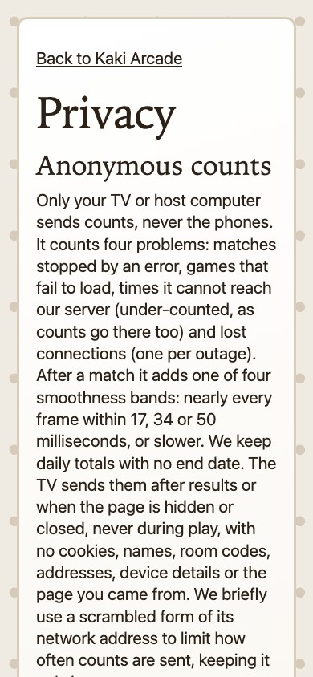 | | |
| 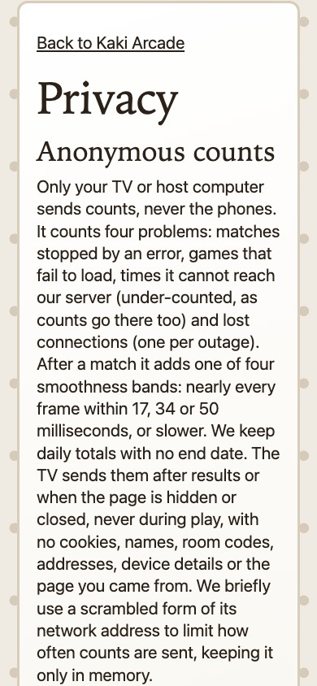 | | |
| 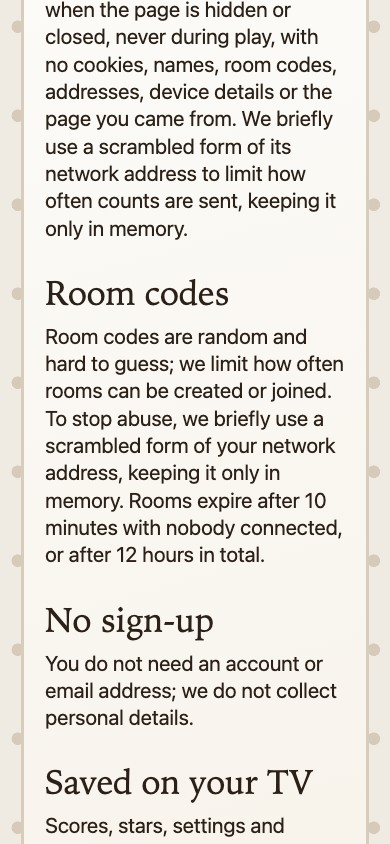 | | |
| 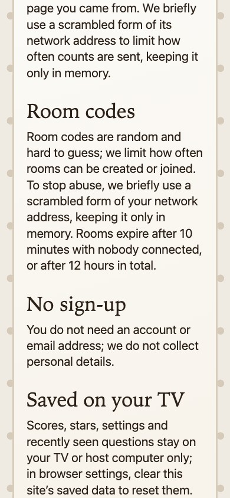 | | |
|  | | |
| 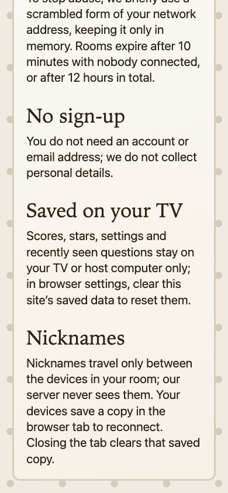 | | |
|  | | |
|  | | |
|  | | |
| 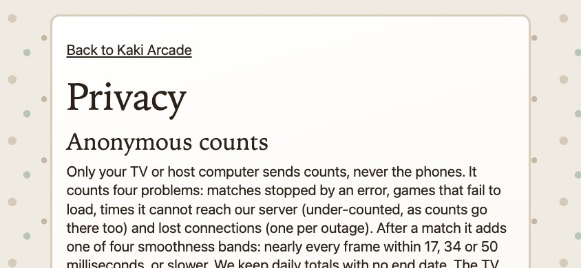 | | |
| 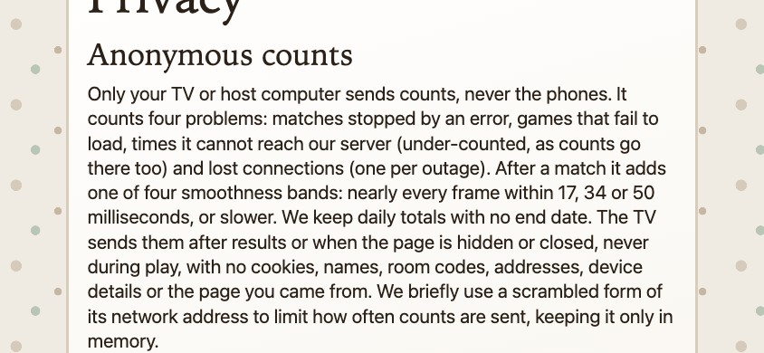 | | |
| 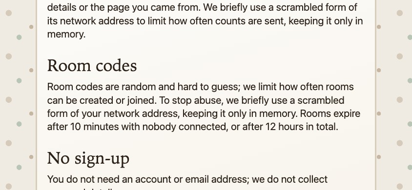 | | |
| 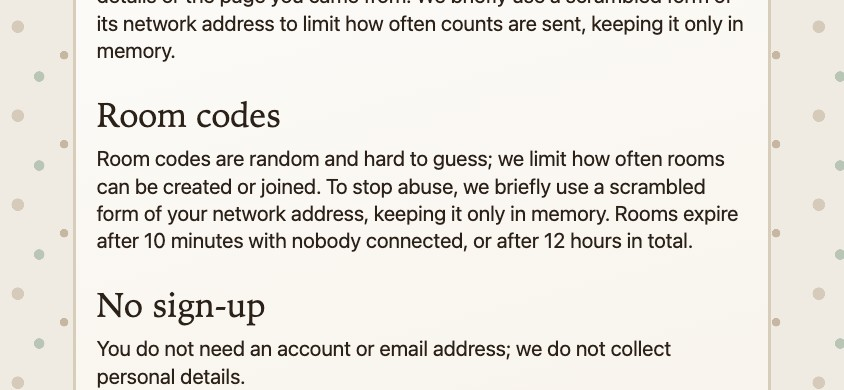 | | |
| 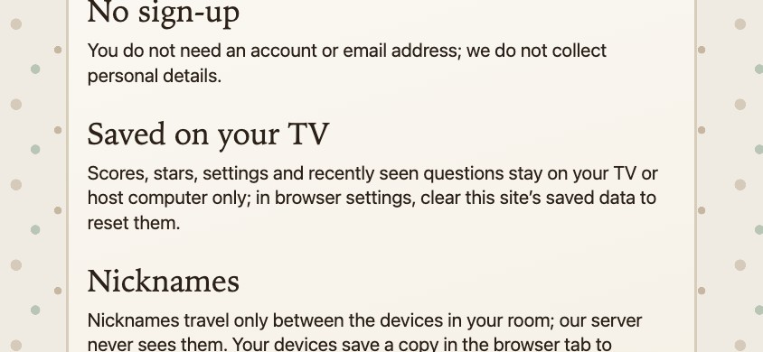 | | |
| 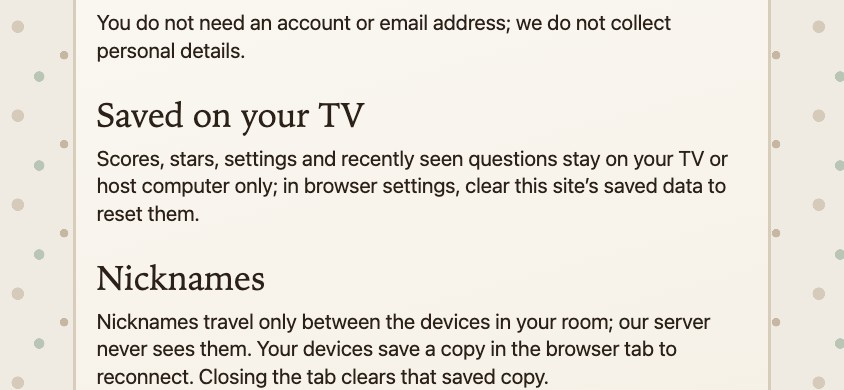 | | |
| 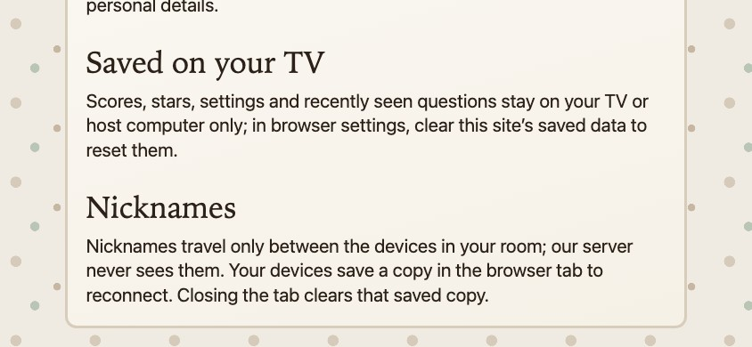 | | |
| 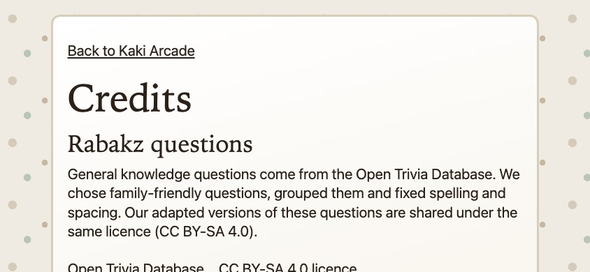 | | |
| 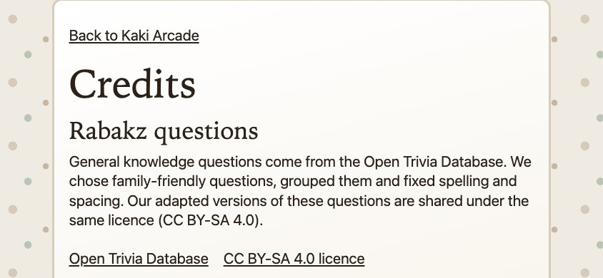 | | |
|  | | |
|  | | |

| Acceptance statement | Pass / fail | Evidence |
|---|---|---|
| DATA-004 short plain-English privacy page covering DATA-001, -002, -003, -005 | Pass | 04, 06, 08–13, 17–23 |
| Privacy fits one TV screen in 1.618 : 1 columns (D-178) | Pass | 04 (47.4 px clear, 34 needed), 06 (31.6 of 22.7); fit.txt |
| RZ-021 credits: OTDB link, CC BY‑SA 4.0 link, changes stated, same-licence offer | Pass (Randy's R-14 spot-check outstanding) | 05, 07, 14–16, 24–27 |
| Phones: one scrolling column, no horizontal overflow, panel end reachable | Pass | 08–27; legal.dom |
| Landing footer: TV bottom-left clear of the help link; phones in flow below it, 55 px targets, tappable, 34 px gap | Pass | 01, 02, 03; legal.dom centre-point hit test |
| "CC BY‑SA 4.0" never breaks after "CC" | Pass | 14, 24 |

> The per-image tables above are the harness template. Looked at by the integrator in this run: 02, 03, 14 and 24 (the stills this round's CSS and copy change); the remaining stills match round 8's, which review 8 opened one by one (`../uat-r8/`).
