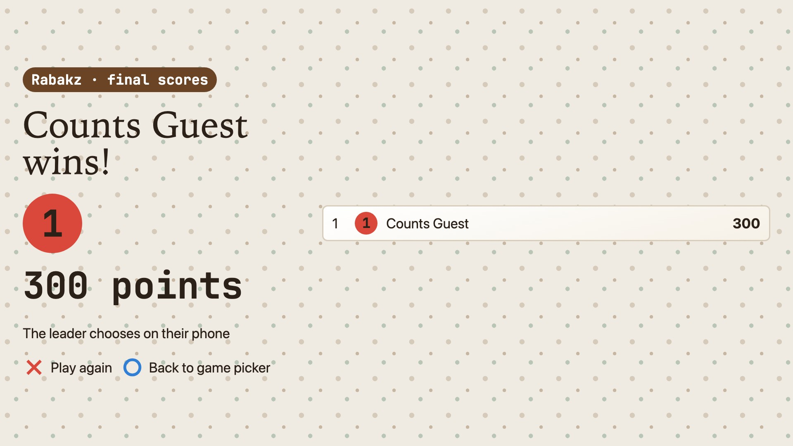

# X-04-counts UAT evidence

Automated execution only. Visual review and acceptance decisions are pending.

Command: `node tools/uat/run.mjs -- X-04-counts --phones 1 --signal-var COUNTS_DEV_READ:true --out round3`
Commit: `514f51a0fa389768f8cdae667aa51ecaa62c65e1`
Viewports: 1920×1080

| Timing | ms | Status |
|---|---:|---|
| Create room through host page | 1259.3 | completed |
| Join Counts Guest | 299.5 | completed |
| Play the shortest Rabakz match with real phone answers | 78038.5 | completed |
| Hide host once and read back today’s anonymous totals | 219.0 | completed |
| Counts Guest | 130.3 | joined |

Expected errors (count):
None

## Real server

| Screenshot | What it shows | Looked at by |
|---|---|---|
|  | | |

| Acceptance statement | Pass / fail | Evidence |
|---|---|---|
| | | |
