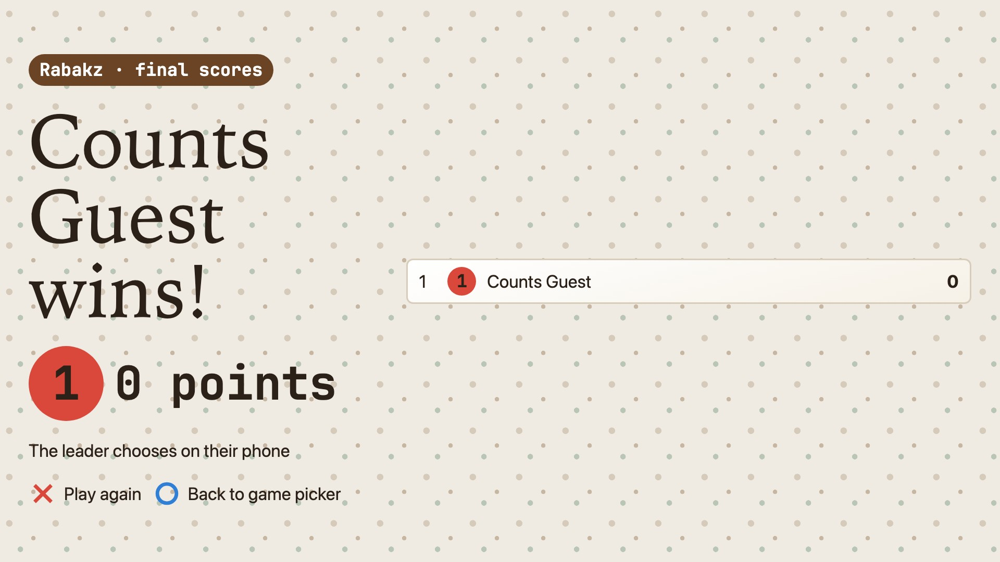

# X-04-counts UAT evidence

Automated execution only. Visual review and acceptance decisions are pending.

Command: `node tools/uat/run.mjs -- X-04-counts --phones 1 --signal-var COUNTS_DEV_READ:true --out round4`
Commit: `d39136d181f6d0400eab84eafe66b04d49993eeb`
Viewports: 1920×1080

| Timing | ms | Status |
|---|---:|---|
| Create room through host page | 1453.0 | completed |
| Join Counts Guest | 281.1 | completed |
| Play the shortest Rabakz match with real phone answers | 77470.4 | completed |
| Hide host once and read back today’s anonymous totals | 3118.0 | completed |
| Counts Guest | 119.4 | joined |

Expected errors (count):
- 2 × host: net::ERR_CONNECTION_REFUSED
- 2 × host: Failed to load resource: net::ERR_CONNECTION_REFUSED
- 1 × host: WebSocket connection to 'ws://127.0.0.1:6741/rooms/SVK3J6WK/host' failed: Error in connection establishment: net::ERR_CONNECTION_REFUSED

## Real server

| Screenshot | What it shows | Looked at by |
|---|---|---|
|  | | |

| Acceptance statement | Pass / fail | Evidence |
|---|---|---|
| | | |
