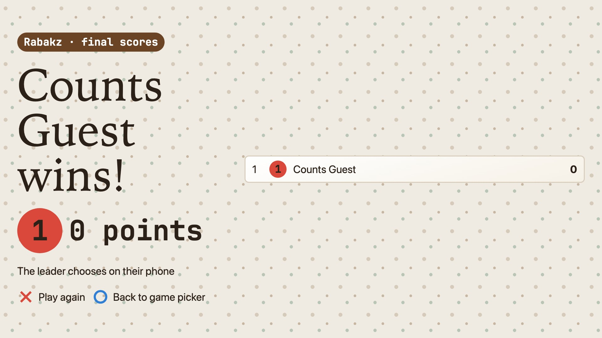

# X-04-counts UAT evidence

Automated execution only. Every file opened by the integrator on 2026-11-18; acceptance passes.

Command: `node tools/uat/run.mjs -- X-04-counts --phones 1 --signal-var COUNTS_DEV_READ:true --out round5`
Commit: `2de2e1ea12834f1c06e9af121252cddf6d62ac23`
Viewports: 1920×1080

| Timing | ms | Status |
|---|---:|---|
| Create room through host page | 1156.3 | completed |
| Join Counts Guest | 270.3 | completed |
| Play the shortest Rabakz match with real phone answers | 78236.0 | completed |
| Hide host once and read back today’s anonymous totals | 3135.6 | completed |
| Counts Guest | 117.8 | joined |

Expected errors (count):
- 2 × host: net::ERR_CONNECTION_REFUSED
- 2 × host: Failed to load resource: net::ERR_CONNECTION_REFUSED
- 1 × host: WebSocket connection to 'ws://127.0.0.1:6741/rooms/GTGP2CY4/host' failed: Error in connection establishment: net::ERR_CONNECTION_REFUSED

## Real server

| Screenshot | What it shows | Looked at by |
|---|---|---|
|  | The real ten-question Rabakz match's final scores on the TV, where the results batch is sent; it proves nothing about counts by itself (the read-back below does). The 0-point win comes from the test tapping the first answer. | Integrator (Claude) |

| Acceptance statement | Pass / fail | Evidence |
|---|---|---|
| Results sends one batch, accepted with 204 | Pass | UAT step "Real host counts accepted by the local worker" |
| A signalling outage after results is counted once (one outage, not per retry) | Pass | counts.json `reconnect:signal: 1` |
| The browser-fired hide delivers the pending reconnect | Pass | counts.json read back from the local worker after leaving the page |
| The drained results batch is not resent | Pass | counts.json frame band still exactly 1 |
| Only allowlisted kinds with positive integers come back | Pass | counts.json |
| No cookie or referrer on the observed requests; hide-path headers covered by the unit test | Pass | counts-requests.json; apps/web/src/browser.test.ts keepalive options |
