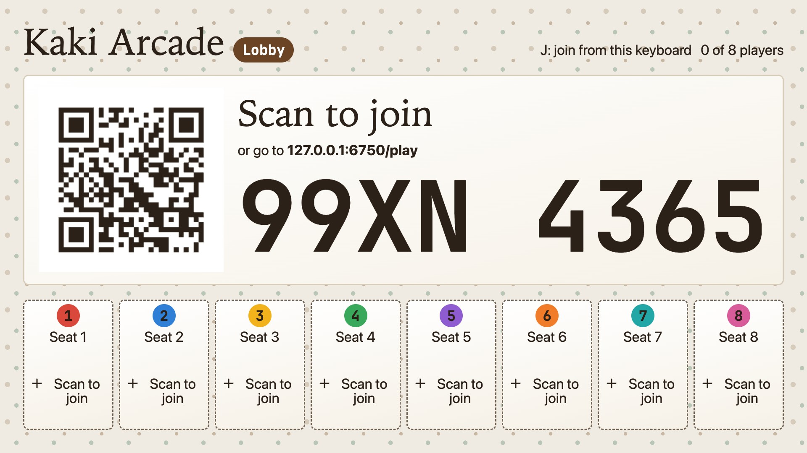
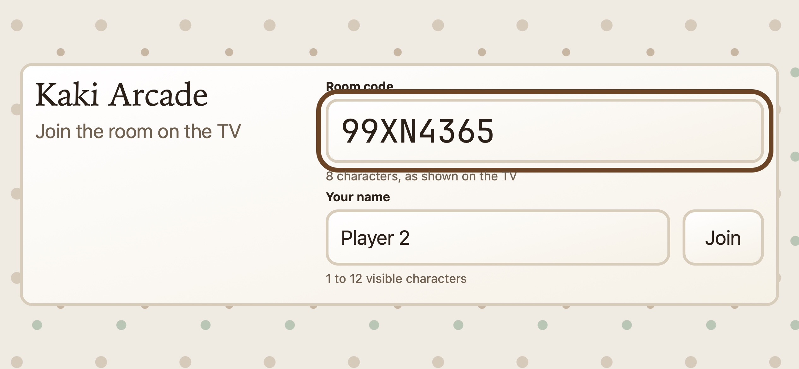
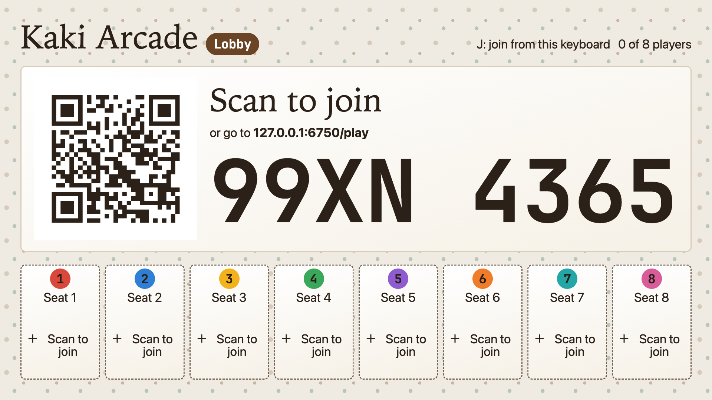
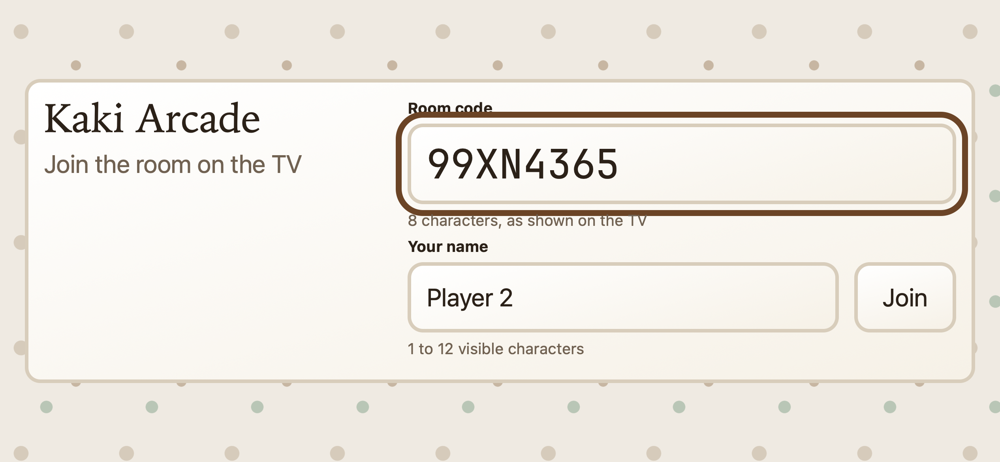

# X-05-browser-matrix UAT evidence

Host browser: chrome 157.0.8103.80
Phone browser: webkit 27.2

REL-004 remains in progress. Automated Mac engines only: WebKit is not real Safari. Edge is not installed; real Safari, iPhone and Android await X-09 / K-07. TV browsers are not covered. REL-006 unsupported proof remains C-14.

Automated execution only. Visual review and acceptance decisions are pending.

Command: `node tools/uat/run.mjs -- X-05-browser-matrix --phones 2 --host-browser chrome --phone-browser webkit --out chrome-webkit --max-mb 24`
Commit: `2aad56d9038687890be56f81fcac48f3338884a3`
Viewports: 1920×1080, 844×390

| Timing | ms | Status |
|---|---:|---|
| Create room through host page | 983.2 | completed |
| Supported pages and room created (REL-006) | 875.2 | completed |
| Phone 1 joins | 15039.8 | failed |

Expected errors (count):
- 1 × host: Failed to load resource: the server responded with a status of 404 (Not Found)

## Real server

| Screenshot | What it shows | Looked at by |
|---|---|---|
|  | | |
|  | | |
|  | | |
|  | | |
|  | | |
|  | | |

| Acceptance statement | Pass / fail | Evidence |
|---|---|---|
| | | |

## Integrator review (2026-11-18): cannot test joining in this engine

Failed as recorded: the phone stays on "Joining the room… Connecting to the host." and the TV
shows 0 of 8 players. Whether real Safari connects is not established either way. A same-page loopback check in Playwright WebKit 27.2
on macOS (`RTCPeerConnection` with one data channel between two connections in one page) gathers
no ICE candidates and the channel never opens (state stays "new"); Chromium 156 opens the same
channel at once with an mDNS host candidate. Playwright WebKit cannot stand in for Safari's
WebRTC here. What this run does show: the TV page and the phone join page load in WebKit and the
unsupported-browser message does not show (REL-006 supported path). Safari and iPhone data
channels stay unproven until real devices (S-05, K-07, X-09).
