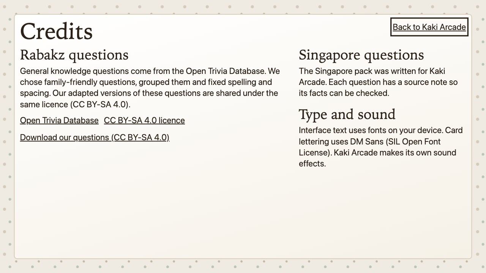
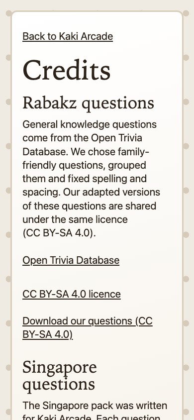

# X-10-credits-download UAT evidence

Host browser: chromium 156.0.8078.4
Phone browser: chromium (legacy iPhone emulation) 156.0.8078.4

Automated execution only. Visual review and acceptance decisions are pending.

Command: `node tools/uat/run.mjs -- X-10-credits-download --phones 1 --out round1`
Commit: `575afa3b7212d4b27b07aa2d019628571d92067a`
Viewports: 1920×1080, 1280×720, 390×844

| Timing | ms | Status |
|---|---:|---|

Expected errors (count):
None

## Real server

| Screenshot | What it shows | Looked at by |
|---|---|---|
|  | | |
|  | | |
|  | | |

| Acceptance statement | Pass / fail | Evidence |
|---|---|---|
| | | |
