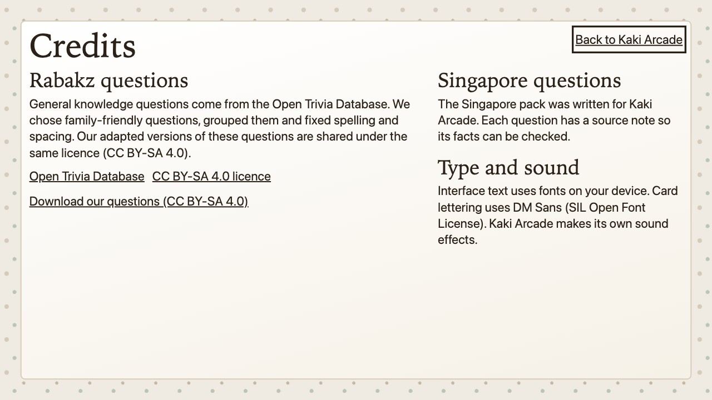
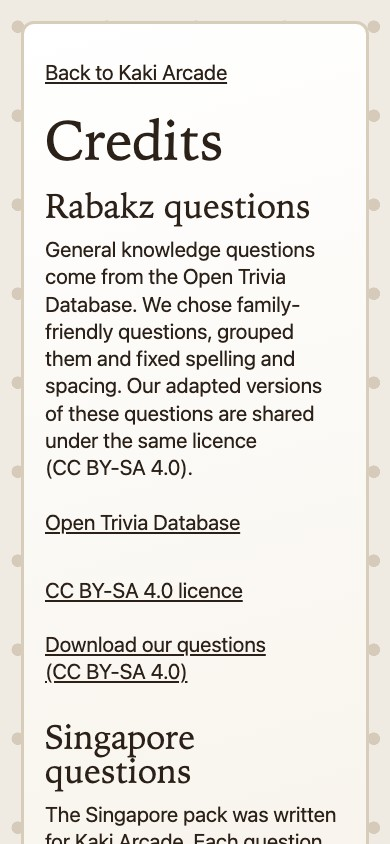

# X-10-credits-download UAT evidence

Host browser: chromium 156.0.8078.4
Phone browser: chromium (legacy iPhone emulation) 156.0.8078.4

Automated execution passed; the integrator and review 2 looked at every still on 2026-11-19.

Command: `node tools/uat/run.mjs -- X-10-credits-download --phones 1 --out round2`
Commit: `0a9181966813708fc477808264904d2377ae8be6`
Viewports: 1920×1080, 1280×720, 390×844

| Timing | ms | Status |
|---|---:|---|

Expected errors (count):
None

## Real server

| Screenshot | What it shows | Looked at by |
|---|---|---|
|  | Credits at 1920 × 1080, no scroll; the download link on its own row under the two source links; Back focused; Enter saved the file (2,342 `otdb-` questions) | Claude integrator and reviewer, 2026-11-19 |
|  | Credits at 1280 × 720, same layout, no scroll; panel ends at 683 of 720 px | Claude integrator and reviewer, 2026-11-19 |
|  | Credits at 390 × 844: three 55 px link rows; "(CC BY‑SA 4.0)" kept whole; no horizontal overflow; tap saved the file (2,342 `otdb-` questions) | Claude integrator and reviewer, 2026-11-19 |

| Acceptance statement | Pass / fail | Evidence |
|---|---|---|
| The link is on Credits with the agreed text | Pass | 01–03 |
| The file holds only the adapted `otdb-` questions and their notice | Pass | download.json; legal-download.test.ts |
| Nothing loads the file until pressed | Pass | DOM test; UAT |
| Fits at 1920, 1280 and 390 | Pass | 01–03 |
